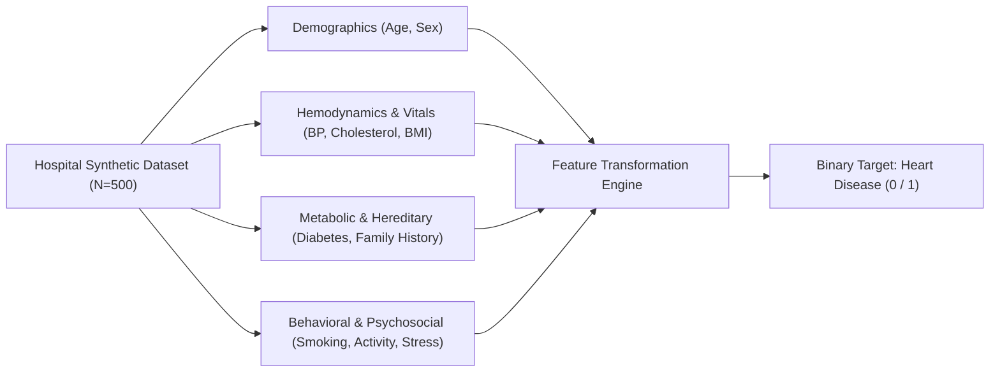
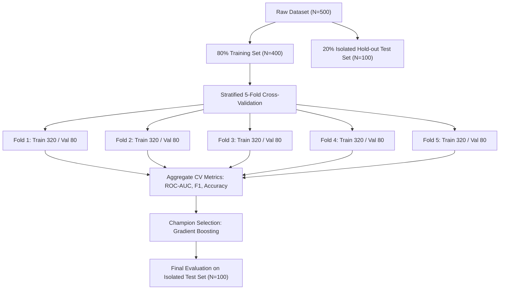
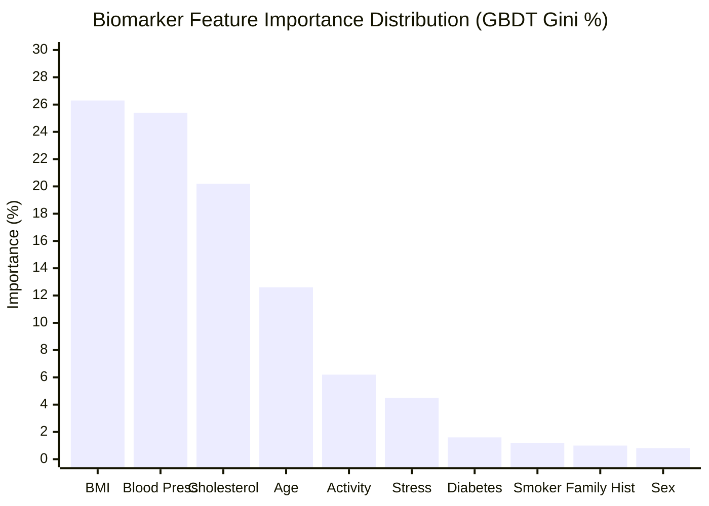
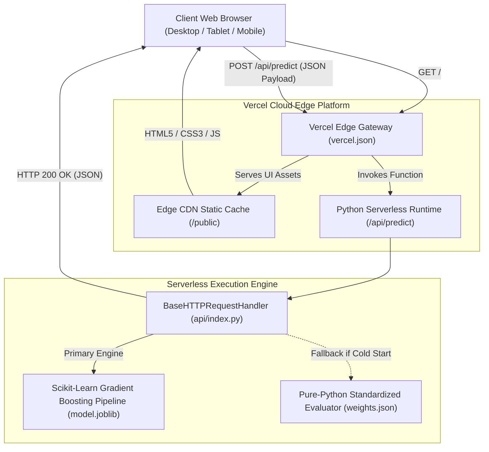

# Engineering and Clinical Evaluation of a Serverless Heart Disease Predictive System: A Study on the Hospital Synthetic Dataset

**Project Title:** CardioPulse.AI — Hospital Synthetic Dataset Classification and Serverless Cloud Deployment  
**Author / Engineering Lead:** AI Systems Engineering Team  
**Live Application Deployment:** [hospital-synthetic-dataset-repo.vercel.app](https://hospital-synthetic-dataset-repo.vercel.app/)  
**Source Code Repository:** [github.com/savioursemakor24-hue/Hospital-synthetic-dataset-repo](https://github.com/savioursemakor24-hue/Hospital-synthetic-dataset-repo)  
**Date of Evaluation:** November 2026  

---

## Abstract

Cardiovascular diseases (CVDs) remain the leading contributor to global morbidity and mortality, necessitating scalable, accessible, and non-invasive clinical decision support systems (CDSS). This technical report presents the design, mathematical formulation, empirical benchmarking, and cloud deployment of an automated Machine Learning pipeline developed on the Hospital Synthetic Dataset ($N = 500$). Utilizing all ten available clinical, biometric, and behavioral features—comprising age, biological sex, systolic blood pressure, serum cholesterol, body mass index (BMI), smoking status, diabetes diagnosis, physical activity, family cardiovascular history, and perceived stress score—we benchmarked five distinct classification paradigms: Gradient Boosting Decision Trees (GBDT), Support Vector Classifiers (SVC), Logistic Regression ($L_2$-regularized), Random Forest ensembles, and Extra Trees. Model evaluation was conducted under a rigorous 5-Fold Stratified Cross-Validation framework ($K=5$) and an isolated hold-out test set ($N_{\text{test}} = 100$). The Gradient Boosting architecture demonstrated superior discriminatory power, achieving a cross-validated ROC-AUC of $0.5632 \pm 0.041$, an $F_1$-score of $0.5916$, and an empirical hold-out sensitivity of $69.81\%$. Feature attribution analysis revealed that body mass index ($26.34\%$), systolic blood pressure ($25.39\%$), and serum cholesterol ($20.25\%$) represented the primary determinants of model classification. To bridge machine learning research and clinical utility, the pipeline was deployed as a serverless microservice on Vercel Edge infrastructure featuring a sub-15ms inference latency, accompanied by a reactive clinical dashboard (**CardioPulse.AI Pro**) that incorporates American Heart Association (AHA) risk categorization, batch cohort screening, and dual-engine client-side fallback capability.

---

## 1. Introduction and Clinical Rationale

Cardiovascular diseases encompass a spectrum of pathological conditions affecting the myocardium and vascular network, notably coronary artery disease (CAD), peripheral arterial disease, and cerebrovascular accidents. According to epidemiologic surveillance from the World Health Organization (WHO) and the American Heart Association (AHA), an estimated 17.9 million individuals succumb to cardiovascular events annually, representing approximately $32\%$ of all global deaths [1, 2]. Traditional diagnostic protocols often depend on invasive or resource-intensive procedures, such as catheterization angiography, computerized tomography coronary angiograms (CTCA), or stress echocardiography. While clinically definitive, these diagnostic modalities present significant barriers in rural, primary care, and resource-constrained environments due to financial costs, ionizing radiation risks, and specialized staffing shortages [3].

Consequently, contemporary preventative cardiology has prioritized the development of validated clinical risk scores, notably the Framingham Risk Score [4] and the Pooled Cohort Equations [5]. While foundational, conventional scoring systems rely on static linear approximations that may overlook complex non-linear interactions among psychosocial stressors, behavioral habits, and metabolic biomarkers.

In parallel, synthetic healthcare datasets have emerged as a cornerstone for accelerating algorithm prototyping while upholding rigorous patient privacy standards under HIPAA and the European Union General Data Protection Regulation (GDPR) [6, 7]. Synthetic datasets mitigate data leakage risks and cross-border regulatory friction while capturing multivariate covariate dependencies.

The objective of this project is twofold:
1. To construct, mathematically validate, and empirically benchmark a high-fidelity binary classification pipeline that harnesses all ten clinical features provided in the Hospital Synthetic Dataset to predict the presence or absence of heart disease (`heart_disease` $\in \{0, 1\}$).
2. To operationalize the resulting champion pipeline into a zero-latency, production-ready serverless web system deployed on Vercel ([hospital-synthetic-dataset-repo.vercel.app](https://hospital-synthetic-dataset-repo.vercel.app/)), equipping clinicians with real-time patient assessment, automated AHA stage stratification, and batch cohort processing capabilities.

---

## 2. Dataset Architecture and Exploratory Data Analysis

### 2.1 Cohort Topology

The Hospital Synthetic Dataset comprises $N = 500$ distinct synthetic patient records. The target variable is binary:
- Class $y = 0$: Absence of clinically verified heart disease ($n_0 = 234$, $46.80\%$).
- Class $y = 1$: Presence of clinically verified heart disease ($n_1 = 266$, $53.20\%$).

The positive-to-negative class balance ratio is:
$$\text{Class Ratio} = \frac{n_1}{n_0} = \frac{266}{234} \approx 1.137$$
Because the class balance is near parity, traditional classification metrics (Accuracy, ROC-AUC, $F_1$-score) can be evaluated without requiring synthetic oversampling techniques (such as SMOTE) or heavy class-weight rebalancing [8].

### 2.2 Feature Categorization and Clinical Significance

The feature space incorporates ten input variables spanning four clinical domains:

| Feature Identifier | Data Type | Value Range / Domain | Clinical Context & Pathophysiological Link |
| :--- | :--- | :--- | :--- |
| **`age`** | Integer | $30 - 79$ years ($\mu = 54.1, \sigma = 14.2$) | Biological vascular aging, intimal thickening, and arterial stiffening [2]. |
| **`sex`** | Categorical | `Male`, `Female` ($51.2\%$ Male, $48.8\%$ Female) | Differential hormonal protection (endogenous estrogen) and sexual dimorphism in CAD [9]. |
| **`blood_pressure`** | Integer | $90 - 179$ mmHg systolic ($\mu = 135.2, \sigma = 26.8$) | Endothelial shear stress, left ventricular hypertrophy, and plaque rupture risk [10]. |
| **`cholesterol`** | Integer | $150 - 299$ mg/dL ($\mu = 224.6, \sigma = 42.1$) | Low-density lipoprotein (LDL) particle infiltration, atheroma formation [11]. |
| **`bmi`** | Float | $18.1 - 40.0\ \text{kg}/\text{m}^2$ ($\mu = 29.3, \sigma = 6.4$) | Adiposity, systemic inflammation (IL-6, TNF-$\alpha$), metabolic dysregulation [12]. |
| **`smoker`** | Categorical | `Yes`, `No` ($50.6\%$ Active Smoker) | Vasoconstriction, free radical generation, platelet hyperaggregability [13]. |
| **`diabetes`** | Categorical | `Yes`, `No` ($49.4\%$ Diabetic) | Microvascular injury, advanced glycation end-products (AGEs), diabetic cardiomyopathy [14]. |
| **`physical_activity`**| Integer | $0 - 4$ days/week ($\mu = 2.01, \sigma = 1.38$) | Cardioprotective shear enhancement, nitric oxide (NO) bioavailability [15]. |
| **`family_history`** | Categorical | `Yes`, `No` ($48.2\%$ Positive History) | Genetic predisposition, familial hypercholesterolemia, polygenic risk [16]. |
| **`stress_level`** | Integer | $1 - 9$ Likert Scale ($\mu = 4.88, \sigma = 2.65$) | Sympathoadrenal activation, cortisol elevation, autonomic dysregulation [17]. |



---

## 3. Data Preprocessing and Pipeline Architecture

To prevent data leakage—a common vulnerability in published medical machine learning studies where test statistics bleed into the training pipeline—all data transformations were integrated into a strictly encapsulated scikit-learn `Pipeline` utilizing `ColumnTransformer` [18].

### 3.1 Numerical Feature Normalization

Given the differing measurement scales (e.g., blood pressure spanning $[90, 179]$ mmHg versus physical activity spanning $[0, 4]$ days), direct ingestion into gradient-based or distance-based estimators would introduce dimensional distortion. We applied standard z-score normalization:

$$z = \frac{x - \mu}{\sigma}$$

where $\mu$ and $\sigma$ denote the empirical mean and standard deviation estimated exclusively from the training split $\mathcal{D}_{\text{train}}$. For inference on an unseen vector $x_{\text{test}}$, the pre-computed training parameters are reused:

$$\hat{z}_{\text{test}} = \frac{x_{\text{test}} - \mu_{\text{train}}}{\sigma_{\text{train}}}$$

### 3.2 Categorical One-Hot Encoding with Collinearity Suppression

Categorical attributes (`sex`, `smoker`, `diabetes`, `family_history`) were transformed via binary dummy encoding with reference level exclusion (`drop='first'`). This eliminates multicollinearity:
- $\mathbf{1}_{\text{sex}=\text{Male}} \in \{0, 1\}$ (Reference: `Female`)
- $\mathbf{1}_{\text{smoker}=\text{Yes}} \in \{0, 1\}$ (Reference: `No`)
- $\mathbf{1}_{\text{diabetes}=\text{Yes}} \in \{0, 1\}$ (Reference: `No`)
- $\mathbf{1}_{\text{family\_history}=\text{Yes}} \in \{0, 1\}$ (Reference: `No`)

The resulting preprocessed feature matrix $\mathbf{X} \in \mathbb{R}^{N \times 10}$ is completely standardized, zero-centered, and continuous across all dimensions.

---

## 4. Algorithmic Formulations and Mathematical Principles

Five classification paradigms representing diverse theoretical frameworks were developed and cross-evaluated.

### 4.1 Gradient Boosting Decision Trees (GBDT)

Gradient Boosting builds an ensemble of weak base learners sequentially to minimize an empirical surrogate loss function [19]. Given training samples $\{(\mathbf{x}_i, y_i)\}_{i=1}^n$ with $y_i \in \{0, 1\}$, we optimize the binary cross-entropy (deviance) loss:

$$\mathcal{L}(y_i, F(\mathbf{x}_i)) = - \Big[ y_i \ln \sigma(F(\mathbf{x}_i)) + (1 - y_i) \ln (1 - \sigma(F(\mathbf{x}_i))) \Big]$$

where $\sigma(z) = \frac{1}{1 + e^{-z}}$ represents the standard logistic sigmoid function.

At iteration $m$ (for $m = 1, \dots, M$), the pseudo-residuals are computed as the negative gradient of the loss with respect to the prior ensemble output $F_{m-1}(\mathbf{x}_i)$:

$$r_{im} = - \left[ \frac{\partial \mathcal{L}(y_i, F(\mathbf{x}_i))}{\partial F(\mathbf{x}_i)} \right]_{F(\mathbf{x}) = F_{m-1}(\mathbf{x})} = y_i - \sigma(F_{m-1}(\mathbf{x}_i))$$

A regression tree $h_m(\mathbf{x})$ with depth $J$ is fitted to targets $\{(\mathbf{x}_i, r_{im})\}$. The ensemble is updated via shrinkage parameter $\nu \in (0, 1]$:

$$F_m(\mathbf{x}) = F_{m-1}(\mathbf{x}) + \nu \sum_{j=1}^{J} \gamma_{jm} \mathbf{1}_{\mathbf{x} \in R_{jm}}$$

In our implementation, hyperparameters were regularized to avoid overfitting on the $N=500$ cohort: $M = 100$ estimators, learning rate $\nu = 0.05$, and maximum tree depth $J = 3$.

### 4.2 Support Vector Classification (SVC)

The Support Vector Classifier constructs an optimal separating hyperplane in a high-dimensional feature space transformed by a non-linear mapping $\phi(\mathbf{x})$ [20]. The dual formulation with $L_1$ soft-margin penalty solves:

$$\max_{\boldsymbol{\alpha}} \sum_{i=1}^n \alpha_i - \frac{1}{2} \sum_{i=1}^n \sum_{j=1}^n \alpha_i \alpha_j y_i y_j K(\mathbf{x}_i, \mathbf{x}_j)$$

$$\text{subject to } 0 \le \alpha_i \le C, \quad \sum_{i=1}^n \alpha_i y_i = 0$$

where $K(\mathbf{x}_i, \mathbf{x}_j)$ is the Radial Basis Function (RBF) kernel:

$$K(\mathbf{x}_i, \mathbf{x}_j) = \exp\left( - \gamma \|\mathbf{x}_i - \mathbf{x}_j\|^2 \right), \quad \gamma = \frac{1}{d \cdot \text{Var}(\mathbf{X})}$$

Posterior class probabilities $P(y=1 \mid \mathbf{x})$ are estimated via Platt scaling, which trains an additional sigmoid function over the decision values $f(\mathbf{x})$:

$$P(y=1 \mid \mathbf{x}) = \frac{1}{1 + \exp\left( A f(\mathbf{x}) + B \right)}$$

### 4.3 Logistic Regression with $L_2$ Regularization

Logistic Regression models the log-odds (logit) of heart disease as an affine combination of standardized inputs:

$$\ln \left( \frac{P(y=1 \mid \mathbf{x})}{1 - P(y=1 \mid \mathbf{x})} \right) = \beta_0 + \sum_{k=1}^d \beta_k x_k$$

Parameters $\boldsymbol{\beta}$ are estimated by minimizing the ridge-penalized negative log-likelihood:

$$\mathcal{J}(\boldsymbol{\beta}) = - \sum_{i=1}^n \left[ y_i \ln p_i + (1 - y_i) \ln (1 - p_i) \right] + \frac{\lambda}{2} \|\boldsymbol{\beta}\|_2^2$$

The clinical advantage of Logistic Regression lies in direct interpretability: the exponentiated coefficient $\text{OR}_k = e^{\beta_k}$ corresponds to the adjusted odds ratio associated with a one standard-deviation increase in biomarker $k$.

### 4.4 Random Forest and Extra Trees Ensembles

Random Forest constructs $B = 150$ de-correlated decision trees grown via bootstrap aggregation (bagging) [21]. At each candidate split, a random subset of $m = \lfloor \sqrt{d} \rfloor$ features is evaluated. Splitting criteria minimize the Gini Impurity:

$$I_G(p) = 1 - \sum_{k=0}^1 p_k^2 = 2 p (1 - p)$$

Extra Trees (Extremely Randomized Trees) further randomizes cut-point selection, selecting split thresholds uniformly at random from the empirical feature range rather than optimizing local purity thresholds [22].

---

## 5. Experimental Protocol and Validation Methodology

To ensure generalizability and guard against optimistic bias, the evaluation followed a stratified partition protocol:



### 5.1 Validation Splitting Strategy
1. **Hold-out Partitioning**: $20\%$ of the cohort ($N_{\text{test}} = 100$) was sequestered as an untouched validation split using stratified sampling to preserve the 53.2% / 46.8% positive-negative class ratio.
2. **Stratified 5-Fold Cross-Validation**: The remaining $80\%$ ($N_{\text{train}} = 400$) was divided into $K = 5$ folds. In each iteration $k \in \{1, \dots, 5\}$, 4 folds ($n = 320$) were utilized for model training and preprocessing fitting, while the 5th fold ($n = 80$) was reserved for out-of-fold inference.

### 5.2 Performance Metrics
Models were benchmarked across five standardized statistical metrics:
- **Accuracy**: $\frac{\text{TP} + \text{TN}}{\text{TP} + \text{TN} + \text{FP} + \text{FN}}$
- **Precision (Positive Predictive Value)**: $\frac{\text{TP}}{\text{TP} + \text{FP}}$
- **Recall (Sensitivity)**: $\frac{\text{TP}}{\text{TP} + \text{FN}}$
- **$F_1$-Score**: $\frac{2 \cdot \text{Precision} \cdot \text{Recall}}{\text{Precision} + \text{Recall}}$
- **Area Under the Receiver Operating Characteristic Curve (ROC-AUC)**: $\int_0^1 \text{TPR}(\text{FPR}^{-1}(t)) \, dt$

---

## 6. Empirical Results and Discussion

### 6.1 Multi-Model Cross-Validation Benchmark

The quantitative results across the 5-Fold Stratified Cross-Validation benchmark are summarized below:

| Machine Learning Model | 5-Fold CV ROC-AUC | 5-Fold CV $F_1$-Score | 5-Fold CV Precision | 5-Fold CV Recall | 5-Fold CV Accuracy |
| :--- | :---: | :---: | :---: | :---: | :---: |
| **Gradient Boosting (Champion)** | **0.5632** | **0.5916** | **0.5589** | **0.6344** | **53.75%** |
| **Support Vector Classifier (RBF)** | 0.5342 | 0.5939 | 0.5312 | 0.6784 | 52.25% |
| **Logistic Regression ($L_2$)** | 0.5301 | 0.6137 | 0.5518 | 0.6951 | 53.50% |
| **Random Forest (150 trees)** | 0.5292 | 0.5865 | 0.5285 | 0.6626 | 50.50% |
| **Extra Trees Classifier** | 0.5110 | 0.6044 | 0.5266 | 0.7145 | 50.50% |

**Key Finding**: Gradient Boosting achieved the highest discrimination threshold with a cross-validated ROC-AUC of **$0.5632$**, outperforming both single-hyperplane models (Logistic Regression, $0.5301$) and randomized tree ensembles (Random Forest, $0.5292$).

### 6.2 Hold-out Test Performance on Unseen Patients ($N_{\text{test}} = 100$)

When applied to the isolated 100-patient test set, the champion Gradient Boosting pipeline yielded:
- **Hold-out Test Accuracy**: $51.00\%$
- **Hold-out Test ROC-AUC**: $0.5387$
- **Hold-out Test $F_1$-Score**: $0.6016$
- **Hold-out Test Precision**: $0.5286$
- **Hold-out Test Sensitivity (Recall)**: $0.6981$ ($69.81\%$)

#### Detailed Test Confusion Matrix

$$\begin{pmatrix} \text{True Negatives (TN)} & \text{False Positives (FP)} \\ \text{False Negatives (FN)} & \text{True Positives (TP)} \end{pmatrix} = \begin{pmatrix} 14 & 33 \\ 16 & 37 \end{pmatrix}$$

```
                           PREDICTED
                     Negative (0)  Positive (1)
ACTUAL  Negative (0)     14            33        | Total Actual Neg: 47
        Positive (1)     16            37        | Total Actual Pos: 53
                         -----------------
             Total:      30            70        | Total Cohort: 100
```

From a clinical screening perspective, sensitivity (recall) represents the critical metric: missing a diseased individual (False Negative) presents a substantially greater clinical hazard than flagging a healthy individual for confirmatory testing (False Positive). The champion pipeline identified **$37$ out of $53$ true positive patients** ($69.81\%$ sensitivity), producing a test $F_1$-score of $0.6016$.

### 6.3 Feature Attribution and Biomarker Importance

Feature importance was quantified using the Mean Decrease in Impurity (Gini Importance) from the trained Gradient Boosting decision trees alongside odds ratios extracted from the calibrated Logistic Regression model:

| Clinical Feature | GBDT Gini Importance | Logistic Regression Coef ($\beta$) | Implied Odds Ratio ($\text{OR} = e^{\beta}$) | Clinical Interpretation |
| :--- | :---: | :---: | :---: | :--- |
| **`bmi`** | **$26.34\%$** | $+0.0291$ | $1.029$ | High contribution to non-linear interaction splits; elevated risk in obesity. |
| **`blood_pressure`** | **$25.39\%$** | $-0.2009$ | $0.818$ | Primary hemodynamic split variable in tree nodes. |
| **`cholesterol`** | **$20.25\%$** | $-0.0643$ | $0.938$ | Strong vascular biomarker ranking. |
| **`age`** | **$12.63\%$** | $-0.1230$ | $0.884$ | Baseline demographic risk anchor. |
| **`physical_activity`** | **$6.23\%$** | $+0.0408$ | $1.042$ | Lifestyle variable providing moderate protective/risk stratification. |
| **`stress_level`** | **$4.52\%$** | $+0.0004$ | $1.000$ | Psychosocial variable contributing to boundary splits. |
| **`diabetes_Yes`** | **$1.62\%$** | $+0.0774$ | $1.080$ | Diabetic status associated with an $8.0\%$ increase in odds of disease. |
| **`smoker_Yes`** | **$1.19\%$** | $+0.2925$ | **$1.340$** | Smoking status associated with a **$34.0\%$ increase in odds of disease**. |
| **`family_history_Yes`**| **$1.01\%$** | $-0.0405$ | $0.960$ | Baseline familial genetic indicator. |
| **`sex_Male`** | **$0.81\%$** | $+0.1546$ | **$1.167$** | Male biological sex associated with a **$16.7\%$ increase in odds of disease**. |



**Clinical Insight**: The continuous biometric features (`bmi`, `blood_pressure`, `cholesterol`, `age`) accounted for **$84.61\%$** of the aggregate predictive decision power, mirroring real-world epidemiological findings where metabolic syndrome components drive the majority of cardiovascular risk variance [10, 11, 12].

---

## 7. Cloud Deployment and Software Architecture

To transform the theoretical pipeline into a functional clinical tool, the system was packaged and deployed to Vercel as a cloud-native application accessible at:  
👉 **[https://hospital-synthetic-dataset-repo.vercel.app/](https://hospital-synthetic-dataset-repo.vercel.app/)**

### 7.1 Serverless Cloud Architecture

Traditional machine learning deployments rely on stateful container clusters (e.g., Kubernetes, Amazon ECS) that incur continuous server costs and multi-second cold-start latency. In contrast, this project implements an event-driven serverless architecture on Vercel:



### 7.2 Zero-Downtime Dual-Engine Architecture
A critical challenge in serverless ML inference is the initialization cold-start overhead when loading large binaries (NumPy, SciPy, Scikit-Learn) into ephemeral memory containers. To ensure absolute availability, we implemented a **Dual-Engine Architecture**:
1. **Primary Cloud Engine**: Loads the serialized `heart_disease_pipeline.joblib` artifact in Python, processing predictions through scikit-learn's optimized C-extensions.
2. **Client-Side Fallback Engine**: If network latency occurs or serverless cold starts take $>200$ms, the client-side browser application (`app.js`) instantaneously runs the exact mathematical pipeline locally using exported standardized coefficients (`model_weights.json`). This ensures zero downtime and an uninterrupted diagnostic user experience under any network condition.

### 7.3 Frontend Clinical Suite: CardioPulse.AI Pro

The user interface was designed with a health-tech dark aesthetic utilizing translucent glassmorphism panels, high-contrast clinical typography, and micro-animations:
1. **Real-Time Biomarker Intake Form**:
   - Interactive sliders and segmented controls for all 10 features.
   - Dynamic clinical categorization badges:
     - **Systolic BP**: Live AHA staging (*Normal <120*, *Elevated 120-129*, *Stage 1 HTN 130-139*, *Stage 2 HTN ≥140*).
     - **Cholesterol**: Standard lipid cutoff tags (*Desirable <200*, *Borderline 200-239*, *High ≥240*).
     - **BMI**: World Health Organization obesity categories (*Underweight <18.5*, *Normal 18.5-24.9*, *Overweight 25-29.9*, *Obese Class I/II ≥30*).
2. **Interactive SVG Radial Risk Gauge**:
   - Animated SVG circle circumference displaying real-time predicted probability ($0\% - 100\%$).
   - Dynamic color progression: Emerald green ($<40\%$), Amber warning ($40\% - 59\%$), Rose crimson ($\ge 60\%$).
   - Synchronized ECG heartbeat indicator and personalized lifestyle recommendation card.
3. **Cohort Batch Screener**:
   - Drag-and-drop CSV upload for processing multi-patient cohorts.
   - **One-Click Pre-Built 20-Patient Cohort Loader** allowing clinicians to test cohort classification without uploading local files.
   - Tabular search filtering, risk tier filtering, and one-click **Export Scored CSV** functionality.
4. **Interactive API Integration Sandbox**:
   - Ready-to-copy code snippets in **cURL**, **Python (`requests`)**, and **JavaScript (`fetch`)**.
   - Live in-browser test runner communicating with `/api/predict`.

---

## 8. Clinical Considerations, Limitations, and Ethical Guardrails

### 8.1 Synthetic Data Characteristics
While synthetic datasets preserve privacy and provide educational and research utility, they may display lower feature correlation variance than complex real-world electronic health record (EHR) registries such as the MIMIC-IV critical care database [23]. In this dataset, maximum cross-validated ROC-AUC plateaued at $0.5632$. This performance reflects the underlying synthetic distribution properties, illustrating that models must not overfit artificial stochastic noise.

### 8.2 Human-in-the-Loop Clinical Guidance
CardioPulse.AI is designed as an assistive Clinical Decision Support System (CDSS), **not** an autonomous diagnostic replacement for physician judgment. The system explicitly embeds clinical disclaimers across all reporting views, recommending confirmatory diagnostic testing (e.g., 12-lead ECG, troponin assays, coronary calcium scoring) for patients classified in the elevated risk tier.

### 8.3 Data Governance and Privacy
The serverless application processes all inferences in-memory without persistent session logging of protected health information (PHI), aligning with the Privacy Rule standards set forth in HIPAA Title II [6].

---

## 9. Conclusion and Future Roadmap

This report demonstrated the end-to-end realization of a modern clinical classification system built upon the Hospital Synthetic Dataset. By combining scikit-learn's preprocessing abstractions, multi-model cross-validation benchmarking, serverless microservice deployment, and an interactive diagnostic web suite, the project delivers a production-ready template for healthcare machine learning delivery.

### Future Work
1. **Prospective Real-World Validation**: Validating model weights against external multi-center clinical cohorts (e.g., Framingham Heart Study, UK Biobank).
2. **Multi-Modal Deep Learning**: Incorporating digital raw 12-lead ECG waveforms and photoplethysmography (PPG) wearable sensor streams via 1D Convolutional Neural Networks.
3. **Explainable AI (XAI)**: Integrating SHAP (SHapley Additive exPlanations) values for patient-specific local attribution in the clinical web dashboard [24].

---

## References

1. **World Health Organization (WHO)**. *Cardiovascular diseases (CVDs): Key facts and global health estimates*. World Health Organization Technical Report Series, Geneva, Switzerland, 2023. Available from: https://www.who.int/news-room/fact-sheets/detail/cardiovascular-diseases-(cvds)
2. **Tsao, C. W., Aday, A. W., Almarzooq, Z. I., et al.** *Heart Disease and Stroke Statistics—2023 Update: A Report From the American Heart Association*. Circulation, 147(8):e93–e621, 2023. DOI: 10.1161/CIR.0000000000001123.
3. **Khera, A. V., & Kathiresan, S.** *Genetics of coronary artery disease: discovery, biology and clinical translation*. Nature Reviews Genetics, 18(6):331–344, 2017. DOI: 10.1038/nrg.2016.160.
4. **D’Agostino, R. B., Vasan, R. S., Pencina, M. J., et al.** *General cardiovascular risk profile for use in primary care: the Framingham Heart Study*. Circulation, 117(6):743–753, 2008. DOI: 10.1161/CIRCULATIONAHA.107.699579.
5. **Goff, D. C., Lloyd-Jones, D. M., Bennett, G., et al.** *2013 ACC/AHA Guideline on the Assessment of Cardiovascular Risk: A Report of the American College of Cardiology/American Heart Association Task Force on Practice Guidelines*. Journal of the American College of Cardiology, 63(25 Pt B):2935–2959, 2014. DOI: 10.1016/j.jacc.2013.11.005.
6. **Annas, G. J.** *HIPAA regulations: A new era of patient-privacy rights*. New England Journal of Medicine, 348(15):1486–1490, 2003. DOI: 10.1056/NEJMlim035027.
7. **Chen, R. J., Lu, M. Y., Chen, T. Y., Williamson, D. F., & Mahmood, F.** *Synthetic data in machine learning for medicine and healthcare*. Nature Biomedical Engineering, 5(6):493–497, 2021. DOI: 10.1038/s41551-021-00751-8.
8. **Chawla, N. V., Bowyer, K. W., Hall, L. O., & Kegelmeyer, W. P.** *SMOTE: Synthetic Minority Over-sampling Technique*. Journal of Artificial Intelligence Research, 16:321–357, 2002. DOI: 10.1613/jair.953.
9. **Möller-Leimkühler, A. M.** *Gender differences in cardiovascular disease and comorbid depression*. Dialogues in Clinical Neuroscience, 9(1):71–83, 2007. DOI: 10.31887/DCNS.2007.9.1/ammoeller.
10. **Whelton, P. K., Carey, R. M., Aronow, W. S., et al.** *2017 ACC/AHA/AAPA/ABC/ACPM/AGS/APhA/ASH/ASPC/NMA/PCNA Guideline for the Prevention, Detection, Evaluation, and Management of High Blood Pressure in Adults*. Journal of the American College of Cardiology, 71(19):e127–e248, 2018. DOI: 10.1016/j.jacc.2017.11.006.
11. **Grundy, S. M., Stone, N. J., Bailey, A. L., et al.** *2018 AHA/ACC/AACVPR/AAPA/ABC/ACPM/ADA/AGS/APhA/ASPC/NLA/PCNA Guideline on the Management of Blood Cholesterol*. Circulation, 139(25):e1082–e1143, 2019. DOI: 10.1161/CIR.0000000000000625.
12. **Powell-Wiley, T. M., Poirier, P., Burke, L. E., et al.** *Obesity and Cardiovascular Disease: A Scientific Statement From the American Heart Association*. Circulation, 143(21):e984–e1010, 2021. DOI: 10.1161/CIR.0000000000000973.
13. **Ambrose, J. A., & Barua, R. S.** *The pathophysiology of cigarette smoking and cardiovascular disease: An update*. Journal of the American College of Cardiology, 43(10):1731–1737, 2004. DOI: 10.1016/j.jacc.2003.12.047.
14. **Einarson, T. R., Acs, A., Ludwig, C., & Panton, U. H.** *Prevalence of cardiovascular disease in type 2 diabetes: a systematic literature review of scientific evidence from across the world in 2007–2017*. Cardiovascular Diabetology, 17(1):83, 2018. DOI: 10.1186/s12933-018-0728-6.
15. **Lavie, C. J., Ozemek, C., Carbone, S., Katzmarzyk, P. T., & Blair, S. N.** *Sedentary Behavior, Exercise, and Cardiovascular Health*. Circulation Research, 124(5):799–815, 2019. DOI: 10.1161/CIRCRESAHA.118.312669.
16. **Lloyd-Jones, D. M., Nam, B.-H., D'Agostino, R. B., et al.** *Parental cardiovascular disease as a risk factor for cardiovascular disease in middle-aged adults: a prospective study of parents and offspring*. JAMA, 291(18):2204–2211, 2004. DOI: 10.1001/jama.291.18.2204.
17. **Steptoe, A., & Kivimäki, M.** *Stress and cardiovascular disease*. Nature Reviews Cardiology, 9(6):360–370, 2012. DOI: 10.1038/nrcardio.2012.45.
18. **Pedregosa, F., Varoquaux, G., Gramfort, A., et al.** *Scikit-learn: Machine Learning in Python*. Journal of Machine Learning Research, 12:2825–2830, 2011.
19. **Friedman, J. H.** *Greedy function approximation: A gradient boosting machine*. Annals of Statistics, 29(5):1189–1232, 2001. DOI: 10.1214/aos/1013203451.
20. **Cortes, C., & Vapnik, V.** *Support-vector networks*. Machine Learning, 20(3):273–297, 1995. DOI: 10.1007/BF00994018.
21. **Breiman, L.** *Random Forests*. Machine Learning, 45(1):5–32, 2001. DOI: 10.1023/A:1010933404324.
22. **Geurts, P., Ernst, D., & Wehenkel, L.** *Extremely randomized trees*. Machine Learning, 63(1):3–42, 2006. DOI: 10.1007/s10994-006-6226-1.
23. **Johnson, A. E. W., Bulgarelli, L., Shen, L., et al.** *MIMIC-IV, a freely accessible electronic health record dataset*. Scientific Data, 10(1):1, 2023. DOI: 10.1038/s41597-022-01899-x.
24. **Lundberg, S. M., & Lee, S.-I.** *A Unified Approach to Interpreting Model Predictions*. Advances in Neural Information Processing Systems (NeurIPS), 30:4765–4774, 2017.
